# sdk-talkingdb

The Python SDK for TalkingDB. It lets your code upload documents to a TalkingDB Text to Tree (TTT) service, wait for them to be indexed, and search them, without writing HTTP calls by hand.


| Start here | Go deeper |
| :--- | :--- |
| [Quickstart](#quickstart) | [Usage and examples: every method](docs/usage-and-examples.md) |
| [Where this fits](#where-this-fits) | [Architecture: retries, errors, polling](docs/architecture.md) |
| [What you get back](#what-you-get-back) | [Troubleshooting](docs/troubleshooting.md) |
| [What this repo is not](#what-this-repo-is-not) | [Example scripts](talkingdb_sdk/) |

All pages: [docs/](docs/README.md).

## Where this fits

<picture>
  <source media="(prefers-color-scheme: dark)" srcset="docs/images/where-sdk-talkingdb-fits-dark.svg">
  
</picture>

<sub>Diagram source: [where-sdk-talkingdb-fits.mmd](docs/diagrams/where-sdk-talkingdb-fits.mmd). Edit it and re-render with the steps in [docs/diagrams](docs/diagrams/README.md).</sub>

In words: your code talks to the SDK, the SDK talks to a TTT service over HTTP, and TTT does the parsing and indexing.

## Quickstart

You need Python 3.12 or newer, a running TTT service (see [module-ttt](https://github.com/TalkingDB/module-ttt#run-it-in-four-steps)), and an API key from that service (`POST /auth/api-keys`).

```bash
pip install "git+https://github.com/TalkingDB/sdk-talkingdb.git"
```

```python
from talkingdb_sdk import TalkingDBClient

client = TalkingDBClient(host="http://localhost:8090", api_key="YOUR_TDB_API_KEY")

job = client.ingest_document("annual-report.pdf")          # upload, then wait until indexed
results = client.match_node([job.result_graph_id], "What are the main risks?", max_results=3)
for element in results:
    print(element)
```

`ingest_document` returns when the job is `COMPLETED` and raises `JobFailedError` if it fails. To upload without waiting, use `submit_document` and poll with `get_job_status` or `wait_for_terminal`; see [docs/usage-and-examples.md](docs/usage-and-examples.md).

> [!TIP]
> Keep the API key out of your code. Read it from an environment variable, for example `api_key=os.environ["TDB_API_KEY"]`.

## What you get back

| Method family | Returns |
| :--- | :--- |
| `submit_document`, `submit_many` | `JobAccepted` (`job_id`, `job_type`, `state`) |
| `get_job_status`, `wait_for_terminal`, `ingest_document` | `JobStatus` (`state`, `stage`, `percent`, `result_graph_id`, `error_code`, ...) |
| `match_node` | A list of matching document elements from the TTT query endpoint |
| `list_namespaces`, `list_public_namespaces` | `Namespace` objects |
| `list_projects`, `rename_project` | `Project` objects |

Types are in [`types.py`](talkingdb_sdk/types.py); errors are in [`exceptions.py`](talkingdb_sdk/exceptions.py).

## What this repo is not

- **Not the service.** It does nothing on its own; it needs a TTT service to talk to.
- **Not async.** Calls block. `example_async.py` shows the submit then poll pattern, not `asyncio`.
- **Not a parser.** Documents are parsed on the server by [package-content-elementizer](https://github.com/TalkingDB/package-content-elementizer).
- **Not for [entity linking](https://en.wikipedia.org/wiki/Entity_linking) or [ontology](https://en.wikipedia.org/wiki/Ontology_(information_science)) queries.** Those services ([package-named-entity-linker](https://github.com/TalkingDB/package-named-entity-linker), [package-parse-tree](https://github.com/TalkingDB/package-parse-tree)) have their own APIs.

## Related repositories

| Repository | Relationship |
| :--- | :--- |
| [module-ttt](https://github.com/TalkingDB/module-ttt) | The service this SDK calls; its README lists every endpoint |
| [flowbot-chatbot-ttt](https://github.com/TalkingDB/flowbot-chatbot-ttt) | A chat app that queries the same `/v1/queries` endpoint from JavaScript |
| [base-tdb-models](https://github.com/TalkingDB/base-tdb-models) | Server side job states and stages that the SDK's enums mirror |

## Further reading

- [Requests documentation](https://requests.readthedocs.io/)
- [Tenacity: retrying library](https://tenacity.readthedocs.io/)
- [HTTP Retry-After header](https://developer.mozilla.org/en-US/docs/Web/HTTP/Headers/Retry-After)

## Code contributors

mayank.g@smarter.codes
richika.r@smarter.codes

## License

Licensed under the GNU Affero General Public License v3.0 ([AGPL-3.0](https://www.gnu.org/licenses/agpl-3.0.html)). See [LICENSE](LICENSE).
