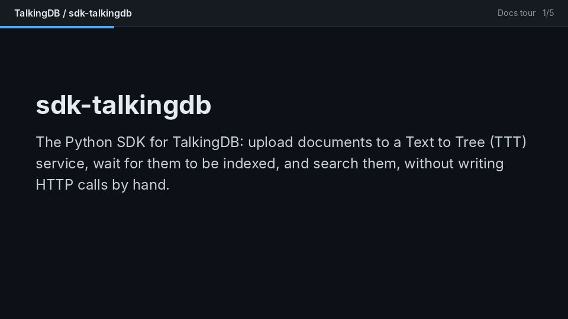

<!-- short-readme -->
<h1 align="center">sdk-talkingdb</h1>

<p align="center"><b>The Python SDK for TalkingDB: upload, wait, search.</b></p>

<p align="center"><a href="#try-it">Try it</a> · <a href="docs/architecture.md">How it works</a> · <a href="docs/usage-and-examples.md">Usage and examples</a> · <a href="docs/troubleshooting.md">Troubleshooting</a> · <a href="docs/reference.md">Full reference</a></p>

<p align="center"><a href="https://github.com/TalkingDB/sdk-talkingdb/stargazers"></a> <a href="https://www.gnu.org/licenses/agpl-3.0.html"></a></p>

<p align="center">
  
</p>
<p align="center"><sub>Drawn from <code>talkingdb_sdk/client.py</code> and <code>example_async.py</code>.</sub></p>

Upload documents to a [module-ttt](https://github.com/TalkingDB/module-ttt) service, wait for them to be indexed and search them, without writing HTTP calls by hand. Errors come back as typed exceptions and failed calls are retried for you.

## What it does

- **Upload and wait**: `ingest_document` returns when the job is indexed.
- **Search**: `match_node` returns the passages that match, with their place in the file.
- **Fail clearly**: one exception per HTTP status, and retries with backoff ([how it works](docs/architecture.md)).

## Try it

```bash
pip install "git+https://github.com/TalkingDB/sdk-talkingdb.git"
```

Then see [usage and examples](docs/usage-and-examples.md) for the three calls.

## Where it fits

Talks to [module-ttt](https://github.com/TalkingDB/module-ttt) over HTTP; the same queries power [flowbot-chatbot-ttt](https://github.com/TalkingDB/flowbot-chatbot-ttt).

## Learn more

| Page | Read it to |
| :--- | :--- |
| [How it works](docs/architecture.md) | see the parts and how data moves |
| [Usage and examples](docs/usage-and-examples.md) | copy working examples |
| [Troubleshooting](docs/troubleshooting.md) | fix a problem |
| [Full reference](docs/reference.md) | read everything that used to be on this page |
| [All docs](docs/README.md) | see every page |

## Support TalkingDB

If sdk-talkingdb saved you time, please [give it a star](https://github.com/TalkingDB/sdk-talkingdb) ⭐. Stars help other developers find the project.

Found a bug, or a document it gets wrong? [Open an issue](https://github.com/TalkingDB/sdk-talkingdb/issues/new). We are always here to help and open to a conversation. Explore the TalkingDB applications at [talkingdb.io](https://talkingdb.io/#applications).

## License

Licensed under the GNU Affero General Public License v3.0 ([AGPL-3.0](https://www.gnu.org/licenses/agpl-3.0.html)). See [LICENSE](LICENSE).
