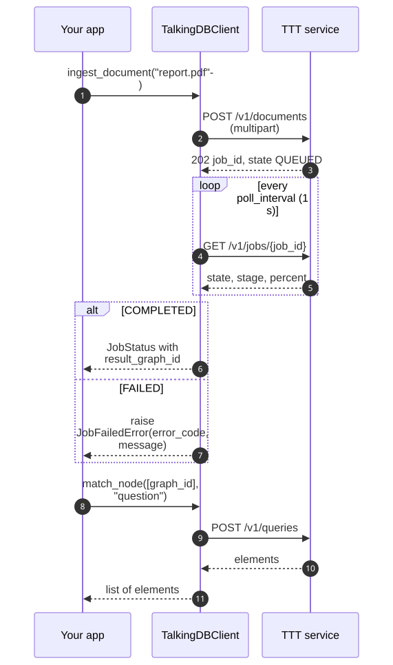

# Architecture

[Docs home](README.md) › Architecture

How the SDK talks to a TTT service: the job lifecycle it follows, how it retries, and how HTTP errors become Python exceptions. For setup, start at the [README](../README.md).

## Upload, wait, search

<picture>
  <source media="(prefers-color-scheme: dark)" srcset="images/how-ingest-document-and-match-node-use-the-ttt-service-dark.svg">
  
</picture>

Diagram source: [how-ingest-document-and-match-node-use-the-ttt-service.mmd](diagrams/how-ingest-document-and-match-node-use-the-ttt-service.mmd). Edit it and re-render with the steps in [docs/diagrams](diagrams/README.md).

In words: upload returns at once with a job ID, the SDK polls until the job ends, and you search the graph the job produced.

## Retries

All calls go through one request method in [`client.py`](../talkingdb_sdk/client.py), using [Tenacity](https://tenacity.readthedocs.io/):

| Call type | Attempts | Wait between attempts | Retried on |
| :--- | :--- | :--- | :--- |
| POST and other calls | 5 | exponential with jitter, from 1 s up to 10 s | network errors, timeouts, HTTP 5xx |
| GET used for polling | 3 | exponential with jitter, up to 5 s, with a 5 s request timeout | the same |

HTTP 4xx responses are never retried, because sending the same request again cannot fix them.

`submit_many` adds one more rule: when the server says its queue is full (`429`), it waits for the `Retry-After` seconds (or 1 s) and tries again, up to `max_full_retries` times (5 by default).

## Errors

Every HTTP error is turned into a typed exception from [`exceptions.py`](../talkingdb_sdk/exceptions.py). All of them inherit from `TalkingDBError`, and HTTP ones carry `status_code`, `body` and `url`.

| HTTP status | Exception | Usual meaning |
| :--- | :--- | :--- |
| 401 | `UnauthorizedError` | Missing or wrong API key |
| 404 | `NotFoundError` | Unknown job, project or namespace |
| 409 | `ConflictError` | The action clashes with the current state |
| 413 | `FileTooLargeError` | File is over the server's limit |
| 415 | `UnsupportedTypeError` | Not a PDF or DOCX |
| 422 | `ValidationError` | A request field is wrong |
| 429 | `QueueFullError` | The server's ingestion queue is full; has `retry_after_seconds` |
| 503 | `SpoolExhaustedError` | The server is short of temporary disk space; has `retry_after_seconds` |
| other | `HTTPError` | Anything else |
| job ended `FAILED` | `JobFailedError` | Raised by `ingest_document`; has `error_code` |

## Threads

Each thread gets its own `requests.Session` (kept in `threading.local`), so one `TalkingDBClient` can be shared by several threads.

## Job states

The SDK's `JobState` and `JobStage` enums mirror the server's, defined in [base-tdb-models](https://github.com/TalkingDB/base-tdb-models/blob/main/docs/architecture.md#job-lifecycle). Terminal states are `COMPLETED`, `FAILED` and `CANCELLED`.

---

**Related:** [Troubleshooting](troubleshooting.md) · [Usage and examples](usage-and-examples.md) · [README](../README.md)
